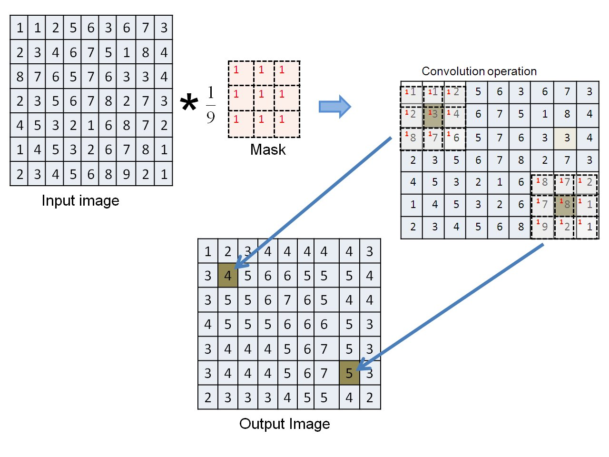
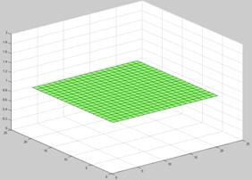
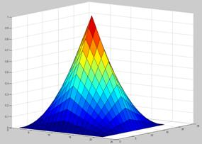
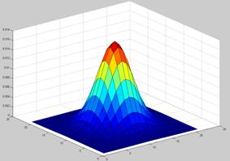
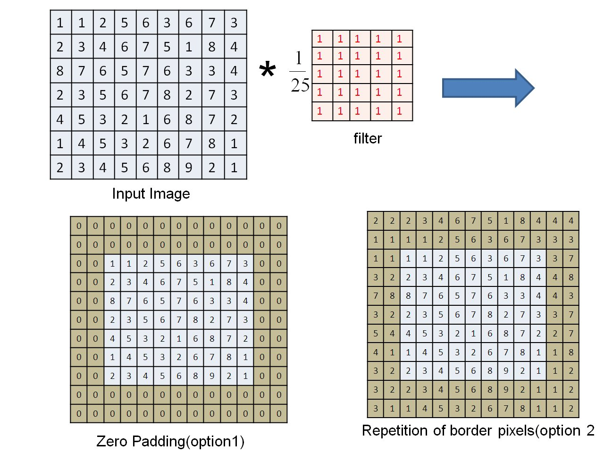

Neighbourhood operations are image processing techniques in which the value of an output pixel depends not only on the corresponding pixel in the input image but also on the values of pixels in its local neighbourhood. They therefore extend the idea of point operations, where each pixel is processed independently.

Neighbourhood operations are useful for modifying and analysing local image characteristics. For example, smoothing operations can reduce fine details and noise, while other operations can enhance edges or emphasize local changes in intensity. Such operations are useful in applications such as image enhancement, image denoising, and feature extraction.

In the **Neighbourhood Operations experiment**, you will study how the size of a neighbourhood and the rule used to combine the pixel values within that neighbourhood affect the resulting image. The experiment considers both linear and nonlinear neighbourhood operations.

### Local Neighbourhood and Mask

Let $f(x,y)$ represent the input image and $g(x,y)$ represent the output image. For a pixel at location $(x,y)$, a neighbourhood $N$ consists of the pixels surrounding the current pixel along with the current pixel itself.

A neighbourhood operation can be represented as

$$
g(x,y)=H_N\left(f(x,y)\right)
$$

where $H_N$ represents the neighbourhood operator.

In practice, a small window or mask is placed over a local region of the input image. The pixel values covered by the mask are combined according to a specified rule to obtain the output value at the corresponding location. The mask is then moved to the next pixel location, and the process is repeated over the image.

The size of the neighbourhood determines how many pixels participate in the operation. For example, a $3 \times 3$ neighbourhood contains nine pixel values, while a $5 \times 5$ neighbourhood contains twenty-five pixel values.

A $3 \times 3$ neighbourhood can be represented using the relative positions

$$
\begin{matrix}
(-1,-1) & (-1,0) & (-1,1) \
(0,-1) & (0,0) & (0,1) \
(1,-1) & (1,0) & (1,1)
\end{matrix}
$$

where $(0,0)$ represents the position of the current pixel.

### Linear Neighbourhood Operations

A linear neighbourhood operation can be performed using a convolution operation between the input image and a mask or filter. The output pixel is obtained by multiplying the pixels in the neighbourhood by the corresponding filter coefficients and adding the resulting values.

For a filter of size $s \times t$, let

$$
a=\frac{s-1}{2}
$$

and

$$
b=\frac{t-1}{2}
$$

For a neighbourhood centred at $(x,y)$, the linear operation can be expressed as

$$
g(x,y)=\sum_{u=-a}^{a}\sum_{v=-b}^{b}w(u,v)f(x+u,y+v)
$$

where $w(u,v)$ represents the filter coefficient or weight associated with the corresponding position in the neighbourhood.

For a $3 \times 3$ filter, the coefficients can be represented as

$$
\begin{matrix}
w(-1,-1) & w(-1,0) & w(-1,1) \
w(0,-1) & w(0,0) & w(0,1) \
w(1,-1) & w(1,0) & w(1,1)
\end{matrix}
$$

The coefficient $w(0,0)$ corresponds to the current pixel. The other coefficients determine how strongly the neighbouring pixels contribute to the output value.

_Figure: Illustration of a convolution operation using a neighbourhood mask._

The figure illustrates how a neighbourhood mask is applied to a local region of an input image. The pixel values covered by the mask are combined according to the corresponding filter coefficients, and the resulting value becomes the output pixel at the centre of that neighbourhood. The mask is then moved across the image so that the same operation can be performed at other pixel locations.

Changing the filter coefficients changes the behaviour of the operation. Such operations are generally referred to as filtering operations, and the matrix of coefficients is referred to as a filter or kernel.

### Smoothing and Averaging Filters

A commonly used linear neighbourhood operation is smoothing. Smoothing reduces rapid variations in pixel values and can therefore reduce fine details and noise in an image.

A simple averaging filter assigns the same weight to every pixel in the neighbourhood. For a $3 \times 3$ averaging filter, each coefficient is

$$
w(u,v)=\frac{1}{9}
$$

and the output pixel is therefore the average of the nine pixels covered by the filter.

_Figure: Surface representation of a straight averaging filter with equal coefficients._

The flat surface represents equal filter coefficients. Since every position in the neighbourhood has the same weight, every pixel contributes equally to the output value. The averaging operation reduces local intensity variations and produces a smoothing effect.

For smoothing filters, the filter coefficients are generally non-negative and satisfy

$$
w(u,v)>0
$$

with the additional condition

$$
\sum_u\sum_v w(u,v)=1
$$

The second condition normalizes the filter weights so that the operation produces a weighted average of the neighbourhood values.

Different arrangements of the filter coefficients produce different smoothing effects.

### Triangular Filter

A triangular filter assigns different weights to pixels within the neighbourhood, with the weights generally decreasing as the distance from the centre increases.

_Figure: Surface representation of a triangular filter._

The surface represents the distribution of filter weights over the neighbourhood. The larger weights near the central region indicate that those pixels have a greater influence on the output value than pixels farther from the centre.

Thus, even when the neighbourhood size remains unchanged, changing the arrangement of the filter coefficients changes the contribution of individual pixels and consequently changes the filtering effect.

### Gaussian Filter

A Gaussian filter also assigns different weights to pixels according to their distance from the centre. The weights are largest near the centre and gradually decrease toward the outer parts of the neighbourhood.

_Figure: Surface representation of a Gaussian filter._

The bell-shaped surface represents the Gaussian distribution of filter weights. Pixels closer to the centre therefore have a greater influence on the output pixel than pixels farther away. This weighted averaging produces a smoothing effect while providing a gradual variation in the contribution of neighbouring pixels.

The averaging, triangular, and Gaussian filters illustrate an important principle of linear neighbourhood operations: **the filter coefficients determine how strongly different pixels in the neighbourhood contribute to the output**.

### Nonlinear Neighbourhood Operations

Not all neighbourhood operations can be represented as a weighted sum of the pixels in the neighbourhood. In a nonlinear neighbourhood operation, the output is determined using a nonlinear rule applied to the values within the neighbourhood.

One important example is the median filter.

#### Median Filter

The median filter replaces the current pixel value with the median of the pixel values within its neighbourhood. To obtain the median, the pixel values in the selected neighbourhood are arranged in increasing order, and the middle value is selected.

For example, a $3 \times 3$ neighbourhood contains nine pixel values. After arranging these nine values in increasing order, the fifth value is the median and can be used as the output pixel value.

Median filtering is particularly useful for reducing impulse noise, commonly known as salt-and-pepper noise. Such noise appears as isolated pixels with unusually high or low intensity values. Since the median is less affected by extreme values than an arithmetic average, median filtering can reduce this type of noise while preserving important image structures.

Unlike a linear filter, the median filter cannot be represented as a convolution using fixed filter coefficients.

### Detail Enhancement Using Neighbourhood Operations

Neighbourhood operations can also be used to emphasize details in an image. One example is unsharp masking, in which a smoothed version of the input image is used to emphasize fine details.

Let $\hat{f}(x,y)$ represent a smoothed version of the input image. The difference between the original and smoothed images is

$$
f(x,y)-\hat{f}(x,y)
$$

This difference represents image details that are reduced by the smoothing operation. These details can be used to enhance the appearance of fine structures and edges in the image.

The amount of detail enhancement can be controlled by a scaling parameter. A general detail-enhancement form can be written as

$$
f_s(x,y)=f(x,y)+\alpha\left[f(x,y)-\hat{f}(x,y)\right]
$$

where $\alpha$ controls the strength of the enhancement.

### Effect of Neighbourhood Size

The size of the neighbourhood determines how much surrounding image information contributes to each output pixel.

A smaller neighbourhood considers a smaller local region and generally preserves more local variation. A larger neighbourhood considers a wider region and can produce a stronger smoothing or filtering effect.

Therefore, changing the neighbourhood size can change both the appearance of the output image and the amount of detail or noise that is retained.

### Border Handling

When a neighbourhood mask reaches the boundary of an image, some of the required neighbouring pixels lie outside the image. These pixels do not have defined values in the original image. A border-handling method is therefore required so that the neighbourhood operation can also be performed at the edges.

Two approaches considered in this experiment are zero padding and repetition of border pixels.

#### Zero Padding

In zero padding, pixels outside the image are assumed to have a value of zero. This extends the image with zero-valued pixels and allows the neighbourhood mask to be applied at the image boundary.

#### Repetition of Border Pixels

In repetition, the values of the pixels at the image boundary are repeated outside the image. This ensures that a complete neighbourhood is available even when the mask is positioned near an image edge.

_Figure: Illustration of zero padding and repetition of border pixels._

The figure shows how the image can be extended at its boundaries so that a neighbourhood mask can be applied to pixels near the edges. The choice of border-handling method can affect the output values near the image boundaries.

### What to Observe in the Neighbourhood Operations Experiment

In this experiment, observe how the output image changes when different neighbourhood operations, filter sizes, and filter coefficients are used.

In particular, observe:

- how a neighbourhood operation uses information from surrounding pixels;
- how changing the filter coefficients changes the effect of a linear filter;
- how an averaging filter produces a smoothing effect;
- how triangular and Gaussian filters give different weights to pixels within the neighbourhood;
- how the median filter can reduce isolated noise;
- how changing the neighbourhood size affects the amount of smoothing or local processing; and
- how different border-handling methods affect pixels near the image boundaries.

These observations demonstrate that the output of a neighbourhood operation depends on both the selected neighbourhood and the rule used to combine the pixel values within that neighbourhood.

### Understanding Neighbourhood Operations

Neighbourhood operations provide a way to process an image using information from a local region rather than treating each pixel independently. Linear operations use filter coefficients to determine the contribution of neighbouring pixels, while nonlinear operations use rules such as ranking and selection.

The size of the neighbourhood, the arrangement of filter coefficients, and the selected processing rule all influence the resulting image. These factors can be used to achieve effects such as smoothing, noise reduction, and detail enhancement.

The key idea of the **Neighbourhood Operations experiment** is that the value of an output pixel can be determined from the values in its local neighbourhood. By changing the neighbourhood size, filter coefficients, or processing rule, different characteristics of the image can be enhanced, suppressed, or preserved.
